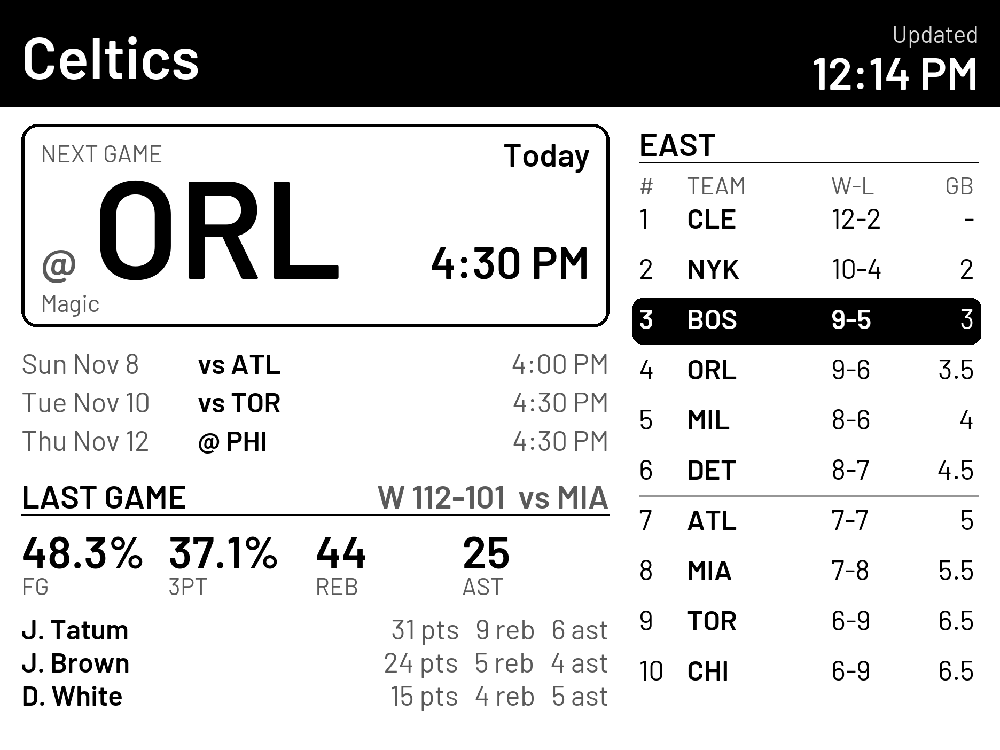

# e-ink-display

A small framework for API-driven e-ink screens on a Raspberry Pi (Pi Zero 2 W + Waveshare IT8951 panel, 1872x1404).
Each screen is a pure Pillow function: **fetch -> normalize -> render an image -> send to the panel**, so you can
preview any page as a PNG on your PC without hardware.



## What's here
| Path | Purpose |
|---|---|
| `config.example.toml` | **Your settings** (team, bus stops, greeting): copy to `config.toml`, which is git-ignored. See `docs/CONFIG.md` |
| `app/style.py` | **Visual style**: type roles, inks, header/card/badge components (every page uses it) |
| `app/pages/team.py` | Team page for the NBA team in your config: next/live game hero, schedule, standings, last-game box score (ESPN) |
| `app/pages/sports.py` | Generic multi-league scoreboard page |
| `app/services/sports_data.py` | ESPN scoreboard fetch + normalization + cache |
| `tools/check_personal.py` | Fails if a value from your `config.toml`/`.env` shows up in the repo (run by tests and the pre-commit hook) |
| `tools/pi.ps1` | PowerShell helpers: connect, status, logs, backup, one-step deploy with rollback |
| `docs/STYLE_GUIDE.md` | The style rules, tokens, states, and how they are enforced by tests |
| `docs/BUS_EXPERIENCE_AUDIT.md` | What makes the bus screen work (the source of the style guide) |
| `docs/HARDWARE.md` | Parts, SPI, driver calls, refresh modes, ghosting |
| `docs/DEPLOYMENT.md` | Install, systemd service, safe updates, Wi-Fi onboarding, gifting a device |
| `docs/API_RECIPES.md` | How to add a new API-driven page |
| `docs/TROUBLESHOOTING.md` | Display, service, network and lockout fixes |
| `docs/PI_CONNECTION.md` | How to connect to the Pi and deploy safely |
| `.githooks/pre-commit` | Local secret check; enable with `git config core.hooksPath .githooks` |
| `docs/INTEGRATION.md` | How to rotate a page into an existing display loop |
| `SECURITY.md` | Where credentials live (not here) |

## Quick start (no hardware needed)
```bash
pip install -r requirements.txt
cp config.example.toml config.toml                # your team, stops, etc. (never committed)
python -m pytest -q
python -m app.pages.team team_preview.png      # live ESPN data for your team -> PNG
python -m app.preview_team                      # every team-page state -> preview/team_*.png
python -m app.preview_sports                    # fixture data -> preview/sports.png
```

## Notes
- ESPN endpoints are **unofficial and undocumented**; they can change or disappear. Check ESPN's terms for your use.
- Pages follow [docs/STYLE_GUIDE.md](docs/STYLE_GUIDE.md): one hero, text of 44 px or more, three grays plus black and white. Tests enforce it.
- Personal settings stay out of the repo: see [docs/CONFIG.md](docs/CONFIG.md).
- Fonts: bundled Barlow (SIL OFL). Licensed fonts and logos are never committed.
- Not affiliated with the NBA, the Boston Celtics or ESPN.

License: MIT
